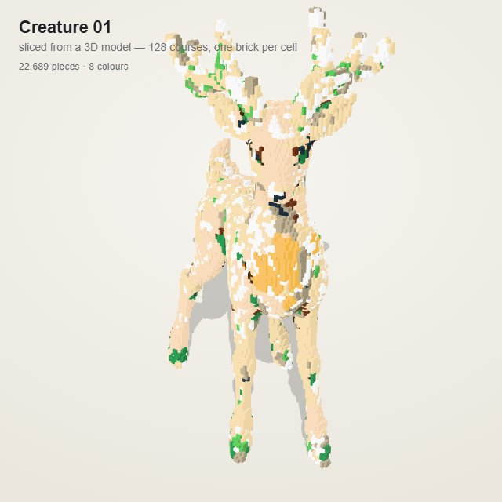
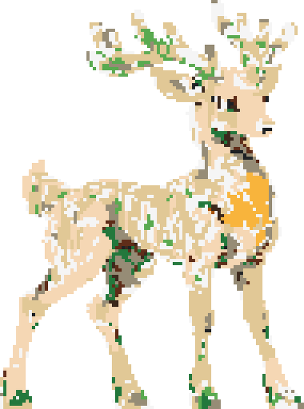
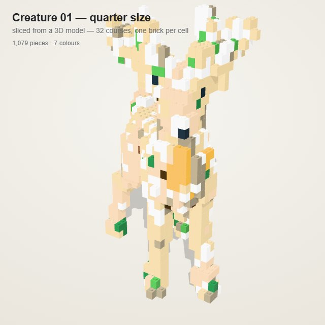
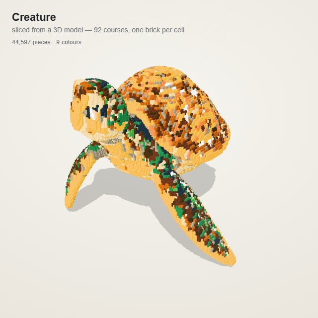

# lego-3d-voxel

**把一个真实的 3D 模型（GLB）按层切开，变成逐层可拼的积木模型。**
给 Claude / Codex 这类 agent 用的 skill：输入一个 `.glb`，输出"每层铺什么砖、什么颜色"的体素数据，再接积木引擎装配成可旋转、可拆装的成品页。

> A skill that slices a 3D model into horizontal brick courses — one brick per voxel cell, colours sampled from the model's own texture.



---

## 它做什么

| 步骤 | 脚本 | 产出 |
|---|---|---|
| 1. 切片 | `scripts/vox.py` | `volume.json`：每格一个 `[x, y, z, 色名]` |
| 2. 验收 | `scripts/preview.py` | 正视 / 侧视 / 背视 + 分层图 |
| 3. 体检 | `scripts/probe.py` | 颜色分布、正面 ASCII 色图、深度剖面 |
| 4. 缩放（可选） | `scripts/downscale.py` | 一半 / 四分之一的同款模型 |
| 5. 装配 | `scripts/build.mjs` | 交给积木引擎，出 `set.html` / `model.ldr` / `parts.csv` |

切片本身**只用 Python + numpy**，不需要任何 3D 软件；第 5 步的装配用的是 [lego-forge](https://github.com/ericfu-tianchi/lego-forge) 引擎（外部依赖，见下文）。

## 为什么是"真切片"，不是"照图建模"

两条路都试过：

- **看图/凭想象建模**：形状必然失真，细节靠猜，颜色全错。用户明确否决过。
- **真按层切片**：几何与颜色**只有一个来源——模型文件本身**。模型有凸起就有一层砖，模型是空心的，切片也是空心的。

代价是件数不设上限（一件模型可能几万块砖），换来的是外形忠实。这个 skill 站的是"形体优先"那一边。

## 安装

skill 就是一个文件夹，放到 agent 能读到的 skills 目录下即可：

```bash
# Claude Code（个人级）
git clone https://github.com/liangdabiao/lego-3d-voxel.git ~/.claude/skills/lego-3d-voxel

# 或项目级
git clone https://github.com/liangdabiao/lego-3d-voxel.git <project>/.workbuddy/skills/lego-3d-voxel
```

`SKILL.md` 头部有 `name` / `description` 的 frontmatter，agent 靠它判断什么时候该用这个 skill。

**依赖**：Python 3.9+、`numpy`、`Pillow`

```bash
pip install numpy pillow
```

## 用法

```bash
# 1) 切片：128 层（推荐先切细，之后要小再缩小）
python scripts/vox.py --glb model.glb --out work/volume.json --courses 128

# 2) 验收：看三视图，确认轮廓不是一根根柱子
python scripts/preview.py --vol work/volume.json --outdir work --px 5 --floors 8

# 3) 体检：颜色分布、正面色图、深度剖面
python scripts/probe.py --vol work/volume.json --stats
python scripts/probe.py --vol work/volume.json --layers 60:80 --cols 20:60
python scripts/probe.py --vol work/volume.json --profile 40,30

# 4) 装配（需要 lego-forge 引擎）
cp scripts/build.mjs work/build.mjs      # 只改里面的 title
node <lego-forge>/bin/lego.mjs build <set-name>
node <lego-forge>/bin/lego.mjs shots <set-name> --quick
```

### 验收标准

- 正视图轮廓与模型一致，**不是**一根根竖直的柱子（那种情况说明切片被"柱化"了，通常是朝向判断错）
- 分层图里同一层颜色连续，没有整片孤立跳动
- 眼睛、嘴、刻线这类深色细节还在（`--darkdetail` 负责保底）
- 空腔仍然是空的（悬空处下方无砖）



## `volume.json` 结构

```json
{
  "nx": 95, "ny": 128, "nz": 73,
  "up": "y", "front": "z",
  "palette": { "Tan": [222, 198, 156], "...": [] },
  "cells": [[x, y, z, "Tan"], ...]
}
```

`cells` 里每个元素就是一块 1×1×3 的砖（体素边长 = 砖宽，三层合一）。`up` / `front` 记录模型的朝向，装配时照此摆正。

## 算法：每个决定都有原因

| 做法 | 为什么 |
|---|---|
| 每个三角形取 7 个采样点（重心 + 3 边中点 + 3 个顶点附近） | 只取中心点会漏掉细三角形，颜色和实心度都会缺 |
| 沿法线方向记录"朝外/朝内" | 判断哪些格子是表面、哪些是被包住的内腔 |
| 3D 泛洪填充（flood fill）判实心 | 悬空处保持空心，不会把鳍与壳之间的缝填死 |
| 颜色按**面积加权**投到 LEGO 色板 | 逐点投票会让大面被小面的杂色带偏 |
| 暗细节保底（Black 占比 ≥ 0.32 即取黑） | 眼睛、嘴缝、刻线在平均色里会被抹平 |
| 区域归并（每个连通区域统一成主色） | 贴图里的碎条纹并掉，但真实的明暗分区保留 |
| 小块吸收（≤3 格并进邻域主色） | 去掉孤立色点，不伤大面积 |
| 3×3×3 去噪（默认 2 轮） | 去掉单格悬空/毛刺 |
| 一格一砖，不智能拼接 | 拼接会把轮廓磨圆，且让"第几层"失去意义 |

这些不是审美偏好，是踩过的坑：`references/pitfalls.md` 里每条都写了现象、根因和验证方式。

## 缩放：一半、四分之一

用户说"缩小一半"，指的是**成品高度的一半**，但**不要**用 `--courses 64` 重切：

```bash
python scripts/downscale.py --src work/volume.json --out work_half/volume.json            # 一半
python scripts/downscale.py --src work/volume.json --out work_quarter/volume.json --factor 4
```

`downscale.py` 对已验收的体素做 2×2×2 归并（每块取多数色），几秒完成、结果确定；重切则要重走全量采样，峰值 1.2 GB 以上，低内存机器会直接 `MemoryError`。

| | 128 层 | 减半 | 再减半 |
|---|---|---|---|
| 网格 | 95×128×73 | 48×64×37 | 24×32×19 |
| 体素 | 69,826 | 10,809 | 1,891 |
| 件数 | 22,689 | 5,055 | 1,079 |



**必须说明的代价**：1 格宽的细结构（鹿角尖、细腿、手指、衣带）归并后会变粗或断开。所以**先切细，再决定要不要缩小**。

## 实测

| 模型 | 层数 | 网格 | 体素 | 件数 | 未连接 |
|---|---|---|---|---|---|
| 海龟 `10-creature` | 92 | 138×92×128 | 206,265 | 44,597 | 44 |
| 鹿 `01-creature` | 128 | 95×128×73 | 69,826 | 22,689 | 74 |
| 角色 `05-character` | 128 | 95×128×53 | 53,549 | 15,092 | 138 |



## 已知限制

- **烘焙图集贴图会花**。有些模型（尤其导出的游戏资产）把每个面片的高光/AO 都烘进贴图，逐格取色就得到满身碎点。这不是切片错，是贴图本身没有干净基色。缓解：增大 `--absorb`，或对体素做几轮 3×3×3 颜色多数投票（会牺牲一点层次）。
- **1 格宽的结构**在低层数下不可靠：会断、会变粗。
- **未连接**是常态：换了颜色的相邻格不能并砖时，检查器会报 disconnected。深色的眼睛、边缘换色最容易触发。
- 只吃 `.glb` / `.gltf`，不支持 FBX / STL / USDZ，先转换。
- 内存：200 万面的模型切片峰值约 1.2 GB，没有页面文件的机器会失败。
- 装配那一步依赖 [lego-forge](https://github.com/ericfu-tianchi/lego-forge) 引擎；本仓库只负责切片和验收。

## 目录

```
SKILL.md                  agent 读的入口：流程、验收标准、坑
references/
  pipeline.md             管线细节：采样、填充、归并的顺序与参数
  pitfalls.md             踩过的坑：现象 / 根因 / 怎么验证
  validation.md           验收清单
scripts/
  vox.py                  切片主程序（自包含：色板、材质归并表内置）
  preview.py              三视图 + 分层图
  probe.py                颜色分布 / ASCII 色图 / 深度剖面
  downscale.py            2×2×2 归并缩放
  build.mjs               装配模板（给 lego-forge 引擎）
assets/                   README 用图
```

## 许可

MIT。装配引擎 [lego-forge](https://github.com/ericfu-tianchi/lego-forge) 亦为 MIT，版权归其作者。
